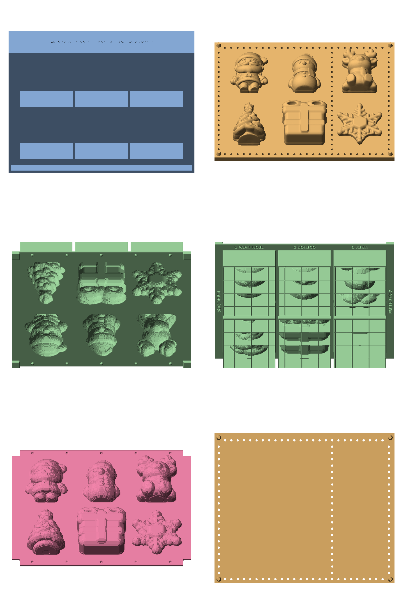

# Molde padrão M (universal)

Imprime **uma vez**: `moldura.stl` (266 x 223 x 50 mm) e `base.stl` (257 x 214 x 8 mm).
Por coleção: só o **miolo** (~375 g de PLA), gerado com `../molde_padrao.py colecao ...`.

## Limites de cada peça (tamanho M)
- Em pé: **até 64 mm de largura x 82 mm de altura**, **até 35 mm de espessura** (sem o pino).
- Pino em D no **centro do retângulo da peça**, lado reto para o topo.
- 2 peças por mesa da Elegoo Mars 5; 6 peças por molde (vagas 1 a 6: cima esq->dir, baixo esq->dir).

## Montagem do silicone
1. Moldura com a tampa na mesa; miolo da coleção dentro (nervuras para baixo, cavidades para cima).
2. Desmoldante; despejar o silicone (~300 ml, ver a prévia de cada coleção).
3. Peças encaixadas na base pelos números 1 a 6 (o miolo tem "1 Papai Noel", "2 Boneco"... gravados na borda).
4. Descer a base até encostar nos batentes; o excesso sai pelos respiros. Peso ou grampos até curar.

## Impressão
- Moldura: tampa na mesa. Base: lado liso na mesa. Miolo: nervuras na mesa (cavidades para cima).
- Testar antes um canto: folgas 0,2 mm (pino), 0,25 mm (base/parede), 0,3 mm (miolo).
