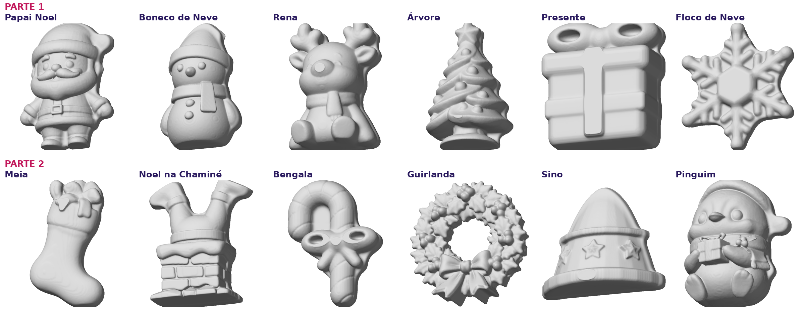

# Natal 2026: 12 peças em 2 moldes

- **Parte 1** (`parte-1/`): Papai Noel, Boneco de Neve, Rena, Árvore, Presente, Floco de Neve.
- **Parte 2** (`parte-2/`): Meia, Papai Noel na Chaminé, Bengala, Guirlanda, Sino, Pinguim.

**12 peças aprovadas (18/11/2026).** Mesma escala (~72 mm de altura), sem alça, pino de encaixe em D
no centro das costas (lado reto para o topo), pronto para a base universal do molde padrão M.
`parte-N/miolo.stl`: miolo do molde padrão M de cada parte (ver `../molde-padrao-M/README.md`).
`mesas-resina/`: arquivos com 2 peças lado a lado para a Elegoo Mars 5 (143 x 90 mm).

Origem: modelos do Printables (Noel 1496792, Boneco 1486887, Rena 1487047, Pinguim 1545550,
Árvore 1492523, Chaminé 1481334, Meia 1454287, Guirlanda 1905264, Sino 701222);
Presente, Bengala e Floco são desenhos próprios (`desenhos_proprios.py`, `floco_desenho.py`).
Peças finais, mesas e miolo: `python ../molde_padrao.py colecao entrada saida "NATAL 2026" "PARTE N de 2" escala p1:Nome ... (6)`.
