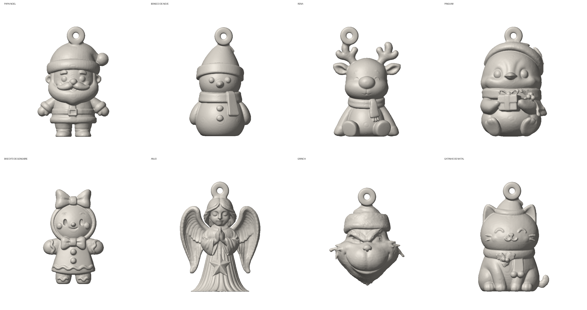

# Kit de Natal 2026: 8 peças para pendurar

| Peça | Arquivo | Medida (L x A x espessura) | Gesso aprox. |
|---|---|---|---|
| Papai Noel | `noel.stl` | 39 x 60 x 16 mm | 16 g |
| Boneco de Neve | `boneco.stl` | 34 x 59 x 16 mm | 15 g |
| Rena | `rena.stl` | 37 x 60 x 16 mm | 14 g |
| Pinguim com presente | `pinguim.stl` | 36 x 60 x 26 mm | 34 g |
| Biscoito de Gengibre | `biscoito.stl` | 33 x 52 x 16 mm | 14 g |
| Anjo | `anjo.stl` | 44 x 60 x 32 mm | 25 g |
| Grinch | `grinch.stl` | 41 x 53 x 16 mm | 12 g |
| Gatinho de Natal | `gato.stl` | 39 x 60 x 16 mm | 19 g |

## Como foram feitas
- Volume real (metade da frente do personagem), costas retas.
- **Argola para pendurar por fora do personagem**, no ponto mais alto: furo de 3,2 mm, anel de 10 mm
  de diâmetro e 6 mm de espessura, unido à peça com curva suave. O furo nunca passa pelo personagem.
- A argola fica na profundidade da própria peça onde ela se prende.
- Partes finas com pelo menos 2 mm (galhada da rena e pelos do Grinch: 3 mm).
- Pinguim e Anjo com corte mais fundo, para manter o gorro e as asas.

## Origem dos modelos (Printables)
Papai Noel 1496792 · Boneco de neve 1486887 · Rena 1487047 · Pinguim 1545550 ·
Biscoito 1445086 · Anjo 1508597 · Grinch 48093 · Gatinho 1492148.
