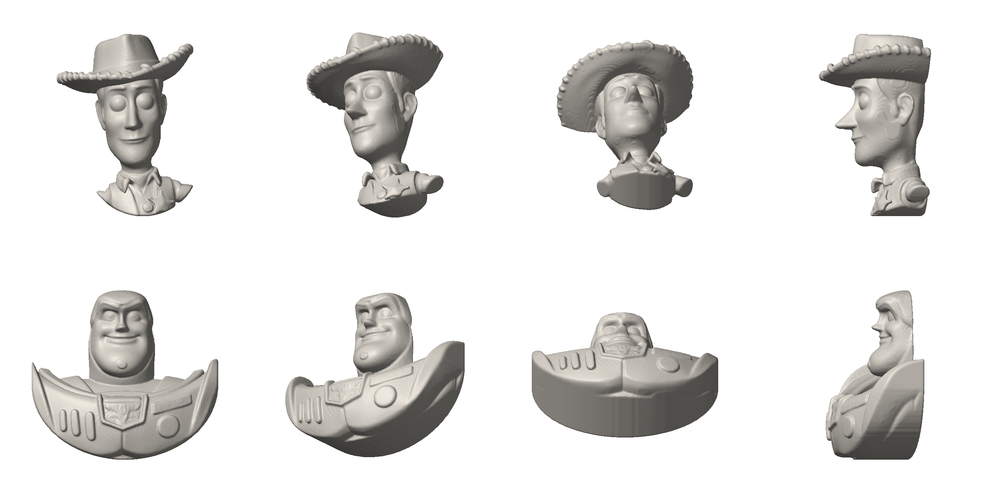

# Toy Story v2: bustos com o volume real



Vistas: de frente, 3/4, de baixo e de lado.

| Peça | Arquivo | Medida (L x A x espessura) | Gesso aprox. |
|---|---|---|---|
| Woody | `woody.stl` | 44 x 58 x 32 mm | 25 g |
| Buzz Lightyear | `buzz.stl` | 60 x 54 x 26 mm | 35 g |

## Como foram feitas
- Partem de modelos 3D detalhados dos personagens (créditos abaixo), não de desenho à mão.
- O volume é o real: nada foi achatado. As costas são cortadas retas para assentar no molde.
- O busto é recortado num contorno oval, com borda arredondada (os braços e as asas ficam de fora).
- Atrás das partes finas (aba do chapéu) há um miolo de suporte escondido, unido com curvas suaves.
- Partes finas são engrossadas até 2 mm, só onde precisam.
- Algumas partes têm contrassaída leve (embaixo da aba, do queixo): o molde de silicone solta sem problema.
- Os olhos do Woody são lisos (como no modelo original): a pupila entra na pintura.

## Como gerar de novo
Ferramenta: `../relevo3d.py`. Comandos usados:

```
python relevo3d.py woody_series_fig.stl woody --girar -90 0 0 --busto 0.40 --tamanho 60 \
    --profundidade 32 --ombro -12 --largura 36
python relevo3d.py buzz_1995.stl buzz --girar -90 -90 0 --busto 0.36 --tamanho 60 --ajuste altura \
    --profundidade 26 --ombro -6 --largura 60 --lateral
```

`woody_series_fig.stl` é a figura principal do modelo "Toy Story Series - Woody";
`buzz_1995.stl` é a peça do Buzz dentro do modelo "Toy Story - Woody & Buzz - 1995".
Os arquivos originais (100 MB e 50 MB) não ficam no repositório: baixe no Printables.

## Créditos dos modelos 3D
- "Toy Story Series - Woody", por Model Magic (Printables 1843114), Creative Commons Domínio Público.
- "Toy Story - Woody & Buzz - 1995", por Model Magic (Printables 1733702), Creative Commons Domínio Público.

Os personagens são da Disney/Pixar: para vender, é preciso licença.
