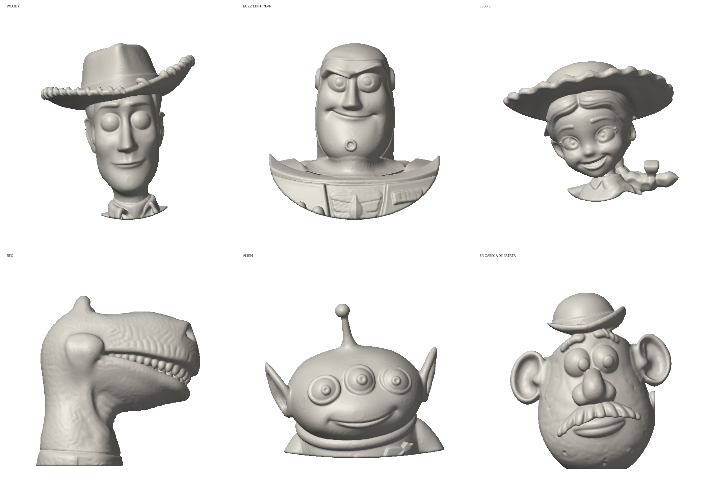

# Toy Story v2: 6 bustos com o volume real

Cada `*.png` mostra a peça de frente, em 3/4, de baixo e de lado.

| Peça | Arquivo | Medida (L x A x espessura) | Gesso aprox. |
|---|---|---|---|
| Woody | `woody.stl` | 52 x 60 x 32 mm | 28 g |
| Buzz Lightyear | `buzz.stl` | 58 x 60 x 38 mm | 53 g |
| Jessie | `jessie.stl` | 59 x 48 x 38 mm | 35 g |
| Rex (de perfil) | `rex.stl` | 56 x 58 x 30 mm | 56 g |
| Alien | `alien.stl` | 61 x 52 x 30 mm | 43 g |
| Sr. Cabeça de Batata | `batata.stl` | 55 x 60 x 32 mm | 48 g |

Todas cabem na impressora (máximo 70 mm) e as malhas estão fechadas.

## Padrão da coleção
- Todos vêm da mesma série de modelos 3D (mesmo autor), então têm o mesmo estilo.
- Volume real, sem achatar. Costas cortadas retas para assentar no molde.
- Busto recortado num contorno oval, com borda arredondada. Braços ficam de fora; orelhas ficam.
- Olhos como no modelo original (sem íris esculpida); os detalhes entram na pintura.
- Woody e Jessie: pouco busto e cabeça grande (só a gola aparece), para dar ênfase ao rosto.
- Buzz: cabeça grande encaixada no peitoral; corte mais fundo (38 mm), vãos do pescoço preenchidos e
  espessura mínima de 4 mm. O pescoço ficou quase 4 vezes mais grosso (seção de 112 para 418 mm²).
- Rex de perfil; o bracinho da frente foi retirado.
- Jessie com a trança e o laço, presos à gola por baixo.
- Sr. Cabeça de Batata: corte das costas logo atrás das orelhas (elas ficam inteiras e apoiadas no fundo);
  braços e pés retirados; vãos entre orelha e cabeça preenchidos por trás.
- Partes finas engrossadas para pelo menos 2 mm.

## Como gerar de novo
Veja `gerar.sh` (ferramenta: `../relevo3d.py`; prévias: `../previa3d.py`).

## Créditos dos modelos 3D
"Toy Story Series" (Woody, Buzz Lightyear, Jessie, Rex, Aliens, Mr. Potato Head), por Model Magic,
no Printables, licença Creative Commons Domínio Público.

Os personagens são da Disney/Pixar: para vender, é preciso licença.
