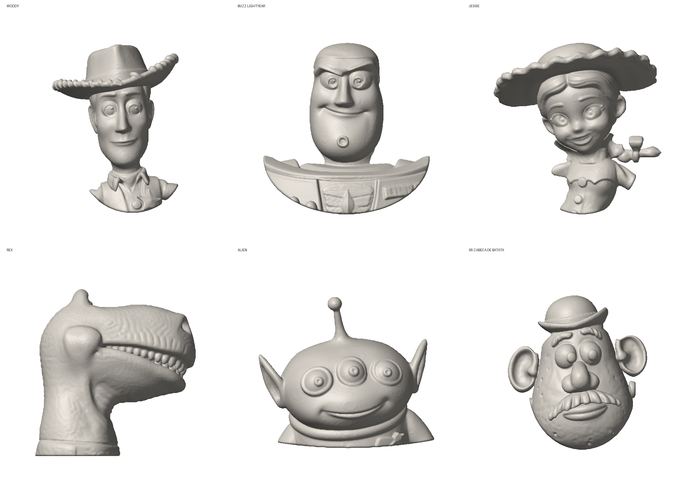

# Toy Story v2: 6 bustos com o volume real

Cada `*.png` mostra a peça de frente, em 3/4, de baixo e de lado.

| Peça | Arquivo | Medida (L x A x espessura) | Gesso aprox. |
|---|---|---|---|
| Woody | `woody.stl` | 44 x 58 x 32 mm | 25 g |
| Buzz Lightyear | `buzz.stl` | 58 x 59 x 28 mm | 28 g |
| Jessie | `jessie.stl` | 58 x 59 x 30 mm | 27 g |
| Rex (de perfil) | `rex.stl` | 56 x 58 x 30 mm | 56 g |
| Alien | `alien.stl` | 61 x 52 x 30 mm | 43 g |
| Sr. Cabeça de Batata | `batata.stl` | 48 x 53 x 30 mm | 34 g |

Todas cabem na impressora (máximo 70 mm) e as malhas estão fechadas.

## Padrão da coleção
- Todos vêm da mesma série de modelos 3D (mesmo autor), então têm o mesmo estilo.
- Volume real, sem achatar. Costas cortadas retas para assentar no molde.
- Busto recortado num contorno oval, com borda arredondada. Braços ficam de fora; orelhas ficam.
- Olhos do Woody e do Buzz: íris em "pratinho" côncavo com um pontinho de brilho em relevo
  (veja `olhos-woody.png` e `olhos-buzz.png`). A pupila entra na pintura. Os outros já vêm com olhos detalhados.
- Buzz: o recorte é mais próximo, então a cabeça ocupa mais da peça e fica encaixada no peitoral.
- Jessie: o vão entre o queixo e a gola foi preenchido como massa alisada (só o vão, nada na frente do rosto).
- Rex de perfil; o bracinho da frente foi retirado.
- Partes finas engrossadas para pelo menos 2 mm.

## Como gerar de novo
Veja `gerar.sh` (ferramenta: `../relevo3d.py`; prévias: `../previa3d.py`).

## Créditos dos modelos 3D
"Toy Story Series" (Woody, Buzz Lightyear, Jessie, Rex, Aliens, Mr. Potato Head), por Model Magic,
no Printables, licença Creative Commons Domínio Público.

Os personagens são da Disney/Pixar: para vender, é preciso licença.
