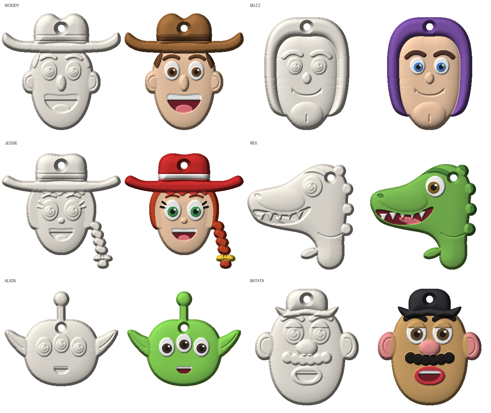

# Lote-teste: Toy Story (6 rostos)

À esquerda de cada par, a peça crua (como sai do molde); à direita, uma sugestão de pintura.

| Peça | Arquivo | Medida (L x A x espessura) | Gesso aprox. |
|---|---|---|---|
| Woody | `woody.stl` | 62 x 61 x 10 mm | 17 g |
| Buzz Lightyear | `buzz.stl` | 44 x 59 x 9 mm | 20 g |
| Jessie | `jessie.stl` | 62 x 60 x 10 mm | 16 g |
| Rex (de perfil) | `rex.stl` | 56 x 55 x 9 mm | 15 g |
| Alienígena | `alien.stl` | 59 x 50 x 9 mm | 11 g |
| Sr. Cabeça de Batata | `batata.stl` | 54 x 61 x 10 mm | 19 g |

Todas cabem na impressora (máximo 70 mm) e as malhas estão fechadas (prontas para fatiar).

## Padrão da coleção
- Só a cabeça, de frente, no mesmo estilo "fofinho": olhos grandes, formas arredondadas.
- O mesmo olho em todas (branco, íris, pupila e um pontinho de brilho rebaixado).
- Mesmas alturas: base de 5 mm, rosto em "almofada" de ~2,5 mm, chapéu/capuz de 4 a 5 mm.
- Costas planas e paredes com ~11 graus de saída. Cada peça é um "mapa de alturas":
  não existe nenhuma contrassaída, então o gesso sempre solta do molde.
- Furo de 3,6 mm no alto para a fita.
- Bordas em relevo separam as cores: fica fácil pintar sem borrar.
- **Exceção:** o Rex está de perfil. De frente ele parecia um sapo; de lado vira dinossauro na hora.

## Como imprimir e fazer o molde
1. Abra o `.stl` no fatiador com as **costas planas para baixo**.
2. Em resina: pode imprimir deitado, sem suportes. Em filamento: camada de 0,08 a 0,12 mm.
3. Lixe de leve e aplique primer, para o silicone copiar uma superfície lisa.
4. Cole a peça (costas para baixo) no fundo de uma caixinha e despeje o silicone por cima.
   Para o furo, deixe um pino de ~3,5 mm no lugar ou faça o furo depois com broca fina.

## Atenção: direitos autorais
Toy Story é da Disney/Pixar. Para teste e uso pessoal tudo bem; **para vender**, é preciso licença.
Uma saída é criar personagens próprios no mesmo estilo (cowboy, astronauta, dinossauro, alienígena).

## Para mudar algo
Tudo está em `toy_story.py` (um bloco por personagem, com as medidas em milímetros).
Gere de novo com `python toy_story.py` (ou `python toy_story.py rex` para só um).
Precisa de: `pip install numpy scipy scikit-image matplotlib trimesh fast-simplification pillow`.
O motor comum fica em `../gesso.py`.

## Referências usadas
Guias de desenho dos personagens (formas da cabeça, olhos, chapéu, orelhas):
easydrawingguides.com (Woody, Buzz, Sr. Cabeça de Batata), easydrawingtutorials.com (Alien, Woody),
artprojectsforkids.org (Jessie, Alien), how2drawanimals.com (cabeça de T-rex), brickimedia.org (rosto do Buzz).
