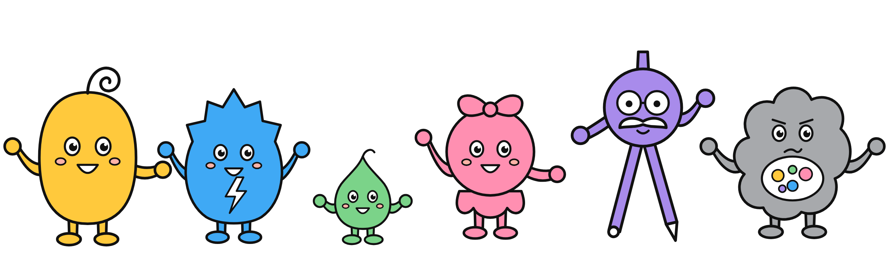
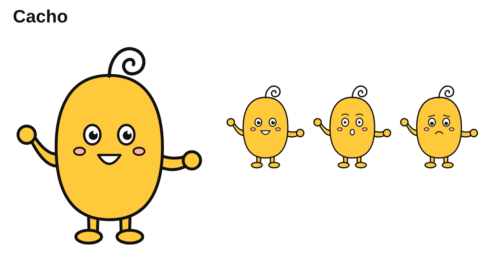
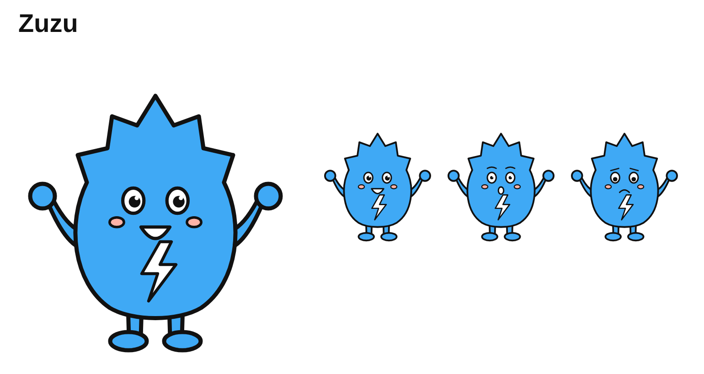
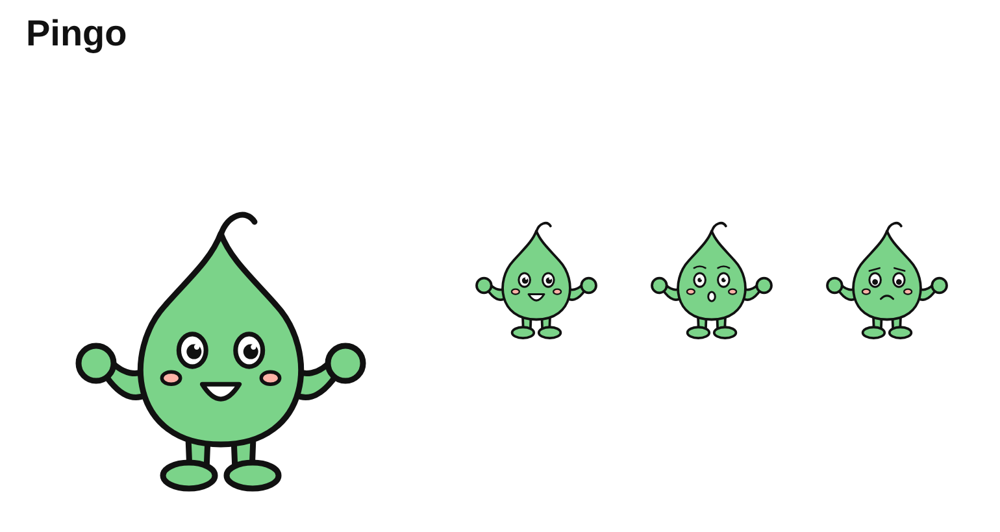
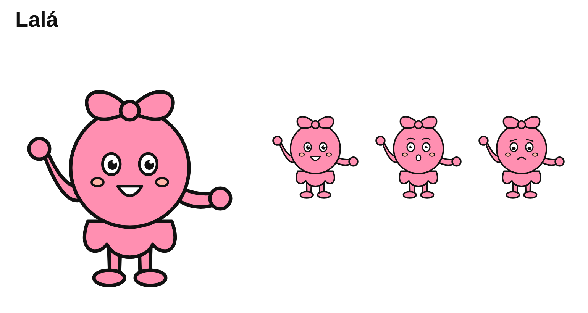
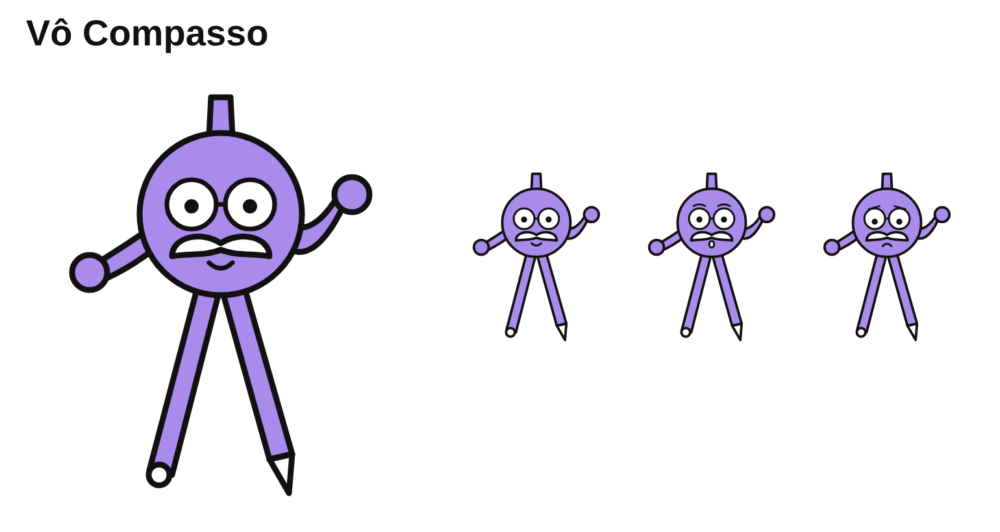
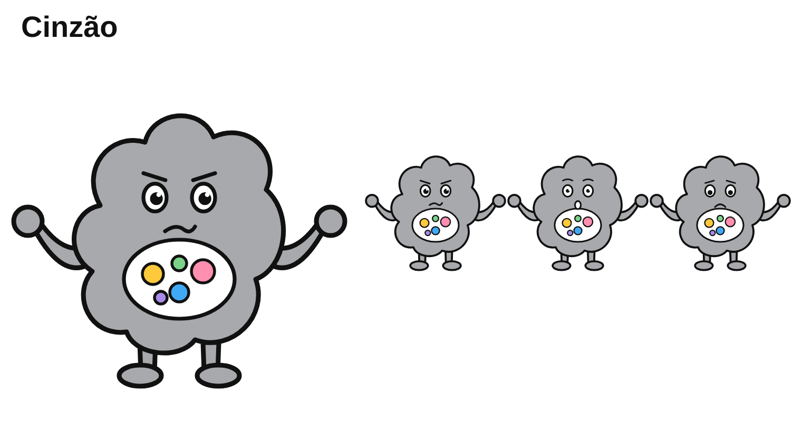

# Bíblia do universo: Os Rabiscos

Versão 1, de 30/10/2026. Esta é a fonte da verdade da marca: todo livro, página, áudio, site e produto segue o que está aqui. O MKT DIRETOR DE ARTE consulta este arquivo antes de cada roteiro. Mudanças só com aprovação do Phelipe.

---

## 1. A ideia em uma frase

Os Rabiscos são bichinhos feitos de traço que moram dentro dos livros. O Cinzão roubou as cores do mundo deles, e **cada página que a criança pinta devolve as cores aos Rabiscos**.

A criança não está "colorindo um desenho": está **salvando os amigos**. Depois, com o "Ganha Vida", ela vê o personagem que pintou dançar com as cores que ela escolheu.

## 2. O mundo: Rabislândia

- Fica **dentro das páginas** dos livros. Cada livro é um pedaço do mundo: o Bosque das Folhas, o Mar de Tinta, o Vale dos Dinossauros, o Céu de Papel, e assim por diante.
- Tudo lá é feito de linhas: as árvores são espirais, as montanhas são zigue-zagues, a chuva são pinguinhos.
- **Regra do mundo:** sem cor, Rabislândia fica triste e devagar. Com cor, tudo volta a se mexer, cantar e brincar.
- **A criança é a "Guardiã (ou Guardião) das Cores"**: a heroína de verdade, chamada pelo nome no livro personalizado.

## 3. A turma

| | Personagem | Feito de | Cor oficial | Jeito | Bordão | Papel na história |
|---|---|---|---|---|---|---|
|  | **Cacho** | Uma linha que termina em espiral (o cacho na cabeça) | Amarelo-sol `#FFC93C` | Corajoso, curioso, otimista; às vezes se mete em confusão por ter pressa | "Um traço de cada vez!" | Protagonista. Puxa a turma para a aventura |
|  | **Zuzu** | Zigue-zague (a crista em raio) | Azul-elétrico `#3FA9F5` | Rápida, inventora, fala depressa, tem ideia para tudo | "Zás, já pensei nisso!" | Resolve problemas com invenções |
|  | **Pingo** | Um pingo de tinta | Verde-folha `#7BD389` | O caçula: tímido, carinhoso, pergunta tudo, chora pinguinhos | "E agora? E agora?" | É com ele que a criança pequena se identifica. Sempre descobre algo importante no fim |
|  | **Lalá** | Laços e voltinhas | Rosa-chiclete `#FF8FB1` | Artista, canta e dança, anima todo mundo | "Dá um giro!" | Traz a música (canções nos áudios) e a coragem quando a turma desanima |
|  | **Vô Compasso** | Um compasso de desenho | Lavanda `#A88BEB` | O avô sábio e calmo; desenha círculos perfeitos; bigodudo e engraçado sem querer | "Calma: todo círculo se fecha." | Mentor. Explica as coisas (o lado educativo) |
|  | **Cinzão** | Uma nuvem borrada | Cinza `#A7A9AC` | Atrapalhado, mais trapalhão que malvado. Rouba as cores porque se acha sem graça sendo todo cinza | "Cor? Que cor? Agora é tudo meu!" | Vilão engraçado. As cores roubadas aparecem na barriga dele. **No último episódio da temporada, ganha as próprias cores e vira amigo** |

Ajudantes do Cinzão: as **Manchinhas**, borrõezinhos que só sabem repetir "Manchaaa!". São fáceis de desenhar e de esconder nas páginas ("encontre as 5 Manchinhas").

### Fichas de modelo (pasta `fichas/`)
- `<nome>-colorir`: corpo inteiro e três expressões, em preto e branco. **É a referência oficial do traço.**
- `<nome>-cores`: a mesma ficha com as cores oficiais, para capas, site, cartas e animação.
- `<nome>-referencia`: só o personagem de frente, sem texto. É a imagem que o motor usa para manter a mesma cara em todas as páginas.
- `turma-colorir` e `turma-cores`: a turma reunida.
- `pagina-exemplo`: página 1 do episódio piloto, já aprovada pela conferência automática do motor (nota 93).
- Tudo é gerado por `desenhar_turma.py` (vetor, sem perda de qualidade em qualquer tamanho). Para mudar um personagem, muda-se ali e roda-se de novo; depois, `node renderizar.js` gera os PNGs.

### Regras de desenho (valem para todas as páginas)
1. **Formas simples e grandes.** Cada personagem cabe numa forma básica: feijão, triângulo em raio, gota, círculo com laço, compasso, nuvem. A criança de 3 anos consegue pintar.
2. **Olhos grandes com brilho, bochechas e boca simples.** Nada de nariz, dente ou dedo.
3. **Braços e pernas sempre separados do corpo, com mãozinhas redondas.** É o que permite o "Ganha Vida" animar o desenho pintado. Nunca desenhar o personagem com os braços colados no corpo.
4. **Traço preto, contínuo e da mesma espessura.** O motor iguala conforme a idade: 2,0 mm para 2-4 anos, 1,3 mm para 5-8 e 0,8 mm para 9-12.
5. **Os personagens nunca mudam de forma, de acessório ou de proporção.** O cacho do Cacho é sempre uma espiral para a direita, e o laço da Lalá tem sempre duas alças.
6. **Cenários com poucas linhas e áreas grandes.** Os detalhes miúdos ficam só no livro de 9 a 12 anos.

## 4. Nomes em outros idiomas (sugestão)

| Português | Inglês | Espanhol |
|---|---|---|
| Os Rabiscos | The Scribblies | Los Garabatos |
| Rabislândia | Scribbleland | Garabatolandia |
| Cacho | Curly | Rulo |
| Zuzu | Zuzu | Zuzu |
| Pingo | Droplet | Gotín |
| Lalá | Lala | Lalá |
| Vô Compasso | Grandpa Compass | Abuelo Compás |
| Cinzão | Grumble Gray | Don Gris |
| Manchinhas | Smudgies | Manchitas |

## 5. Temporada 1 (12 episódios, um por mês no clube)

| Ep. | Título | Onde | Cor devolvida | O que a criança aprende |
|---|---|---|---|---|
| 1 | **O dia em que as cores sumiram** | Bosque das Folhas | Verde | Apresentação da turma; cores primárias |
| 2 | O Mar de Tinta | Fundo do mar | Azul | Animais do mar |
| 3 | O Vale dos Dinossauros | Pré-história | Laranja | Dinossauros |
| 4 | Viagem ao Céu de Papel | Espaço | Roxo | Planetas e estrelas |
| 5 | A Fazenda Rabiscada | Fazenda | Vermelho | Animais da fazenda; de onde vem a comida |
| 6 | Os Rabiscos no Brasil | Floresta brasileira | Verde-amarelo | Folclore (Saci, Iara, Curupira em versão Rabisco) e fauna |
| 7 | A Fábrica de Doces | Mundo dos doces | Rosa | Formas geométricas |
| 8 | O Polo dos Pinguins | Neve | Branco e azul-claro | Frio e calor; animais do gelo |
| 9 | A Cidade dos Lápis | Cidade | Cinza que vira colorido | Profissões |
| 10 | O Circo da Lalá | Circo | Todas | Música e ritmo |
| 11 | O Vulcão Borbulhante | Vulcão | Vermelho e laranja | Natureza (com cuidado para não assustar) |
| 12 | **A cor do Cinzão** | Castelo do Cinzão | A cor do próprio Cinzão | Amizade: o Cinzão descobre que também tem cor, e vira amigo |

Cada episódio termina com um **gancho para o próximo** ("Mas o que é aquele barulho no mar?").

## 6. Episódio 1 (piloto)

O roteiro completo para o motor está em [`episodios/ep01/roteiro.json`](episodios/ep01/roteiro.json): 24 páginas, para 5 a 8 anos. Resumo:

1. O Cacho acha o Pingo chorando: a flor dele ficou sem cor *(página de exemplo)*.
2. A turma se reúne na casa do Vô Compasso.
3. O Vô Compasso conta que o Cinzão aspirou as cores do bosque.
4. A Zuzu inventa um "Detector de Cores".
5 a 20. A turma passa pelo bosque. Em cada página, um pedaço do mundo espera a criança pintar: árvore-espiral, cogumelos, borboletas, o lago, a ponte em zigue-zague, as Manchinhas escondidas, a Lalá cantando para acordar os pássaros.
21. O Cinzão aparece, tropeça e solta um pouco das cores da barriga.
22. A turma pega as cores, e o bosque volta a ficar verde.
23. Festa no bosque.
24. O gancho: uma garrafa chega boiando com um mapa do Mar de Tinta.

Extras do livro (pelo motor e pela linha da sala MARKETPLACE):
- página "Este livro pertence a", com o nome da criança no PDF personalizado;
- página final com o QR code da história em áudio e do "Ganha Vida";
- "Encontre as 5 Manchinhas" escondidas ao longo do livro;
- uma palavra em inglês por página na versão bilíngue.

## 7. A marca: cuidado com o nome (decidir antes de registrar)

Já existem no Brasil livros com nomes parecidos:
- **"Rabisco e Borrão"**, série de Ethan Long publicada pela Brinque-Book. Por isso o vilão **não** se chama Borrão.
- **"O Rabisco"**, de Iara Mastine.

"Rabisco" também é uma palavra comum, o que deixa o registro da marca mais fraco no INPI. A sugestão:
- **"Os Rabiscos"** continua sendo o nome do povo dentro da história (é o que as crianças vão falar).
- **A marca registrada** precisa ser um nome mais distintivo. Opções para checar no INPI (busca.inpi.gov.br) nas classes 16 (livros e papelaria), 9 (arquivos digitais), 28 (brinquedos) e 41 (entretenimento e educação):
  - **Rabislândia**: o nome do mundo; é distintivo e ainda remete aos Rabiscos;
  - **Cacho & Turma**;
  - **Guardiões das Cores**: o "título" da criança no livro.
- Antes de gastar com logo, site e registro: busca no INPI e um advogado de marcas para confirmar.

Sobre a autoria: as fichas foram desenhadas por código, sob direção do Phelipe, e a data fica registrada no Git. Para fortalecer o registro, o ideal é um ilustrador finalizar a versão "oficial" a partir destas fichas, com contrato de cessão de direitos.
